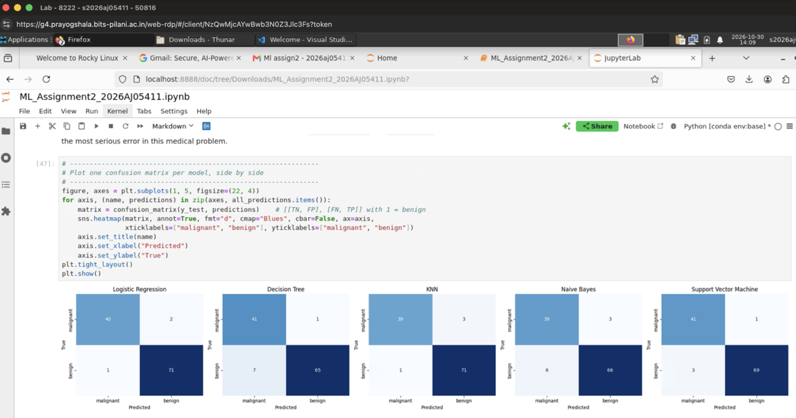

# Classifier Comparison Lab

**Student:** Nelli Haritha  
**BITS ID:** 2026AJ05411  
**Course:** M.Tech (AIML) Machine Learning, Assignment 2

## a. Problem statement

This project compares five classification models on the same public binary classification dataset and exposes their saved models through an interactive Streamlit application. The app accepts compatible test data, loads a selected saved model, and displays Accuracy, AUC, Precision, Recall, F1, MCC, a confusion matrix, and a classification report without retraining.

## b. Dataset description

The project uses the **Breast Cancer Wisconsin Diagnostic** dataset, a binary classification dataset originally published through the UCI Machine Learning Repository and available through `sklearn.datasets.load_breast_cancer`.

- Instances: 569
- Input features: 30 numeric features
- Target: `target` (`0 = malignant`, `1 = benign`)
- Train/test split: 80% / 20%, stratified
- Random state: 2026
- Test data file: `test_data.csv`

The dataset satisfies the assignment minimum of 12 features and 500 instances. The scikit-learn copy preserves the public dataset values and feature definitions.

UCI source: https://archive.ics.uci.edu/dataset/17/breast+cancer+wisconsin+diagnostic

Kaggle mirror: https://www.kaggle.com/datasets/uciml/breast-cancer-wisconsin-data

## c. GitHub repository link

- GitHub repository: https://github.com/nelliharitha123-source/ML_Assignment_2_2026AJ05411
- Live Streamlit app: https://mlassignment22026aj05411.streamlit.app/

### Repository contents

```text
ML_Assignment_2_2026AJ05411/
|-- app.py
|-- train_models.py
|-- ML_Assignment2_2026AJ05411.ipynb
|-- build_submission_pdf.py
|-- requirements.txt
|-- README.md
|-- test_data.csv
|-- metrics.csv
|-- metrics.json
|-- metadata.json
|-- model/
|   |-- logistic_regression.joblib
|   |-- decision_tree.joblib
|   |-- knn.joblib
|   |-- naive_bayes.joblib
|   `-- support_vector_machine.joblib
`-- bits_virtual_lab_screenshot.png
```

## d. Models used

1. Logistic Regression with StandardScaler
2. Decision Tree Classifier with `max_depth=5`
3. K-Nearest Neighbour with `n_neighbors=7` and StandardScaler
4. Gaussian Naive Bayes with StandardScaler
5. Support Vector Machine with RBF kernel, probability estimates, and StandardScaler

### Comparison table (test set, 114 rows)

| ML Model Name | Accuracy | AUC | Precision | Recall | F1 | MCC |
|---|---:|---:|---:|---:|---:|---:|
| Logistic Regression | 0.9737 | 0.9927 | 0.9726 | 0.9861 | 0.9793 | 0.9433 |
| Decision Tree | 0.9298 | 0.9395 | 0.9848 | 0.9028 | 0.9420 | 0.8588 |
| KNN | 0.9649 | 0.9936 | 0.9595 | 0.9861 | 0.9726 | 0.9245 |
| Naive Bayes | 0.9211 | 0.9848 | 0.9565 | 0.9167 | 0.9362 | 0.8341 |
| Support Vector Machine | 0.9649 | 0.9954 | 0.9857 | 0.9583 | 0.9718 | 0.9260 |

### Observations

Positive class = benign. Test set = 114 rows (42 malignant, 72 benign).

| ML Model Name | Observation about model performance |
|---|---|
| Logistic Regression | Best overall: 111 of 114 correct, with only 3 errors (2 missed malignant, 1 false alarm). It has the highest Accuracy (0.9737), F1 (0.9793), and MCC (0.9433), and ties KNN for the best Recall (0.9861). Its AUC (0.9927) is only slightly below SVM and KNN. After scaling, the two classes are almost linearly separable, so a simple linear boundary works very well. |
| Decision Tree | 106 correct, 8 errors. It misses only 1 malignant tumour, but it labels 7 benign tumours as malignant, which gives it the lowest Recall (0.9028). Its AUC (0.9395) is the lowest because a depth-5 tree outputs only a few distinct leaf probabilities, which ranks cases poorly. It is the easiest model to interpret, but its single axis-aligned splits generalise less well than the other models. |
| KNN | 110 correct, 4 errors (3 missed malignant, 1 false alarm). It ties for the best Recall (0.9861) and has the second-best AUC (0.9936). However, it misses more malignant cases than Logistic Regression, SVM, or Decision Tree, so its Precision (0.9595) is lower. It only works well because the features are standardised: without scaling, large-valued features such as area would dominate the distance calculation. |
| Naive Bayes | Weakest model: 105 correct, 9 errors (3 missed malignant, 6 false alarms), with the lowest Accuracy (0.9211) and MCC (0.8341). It assumes the features are independent, but many are strongly related (radius, perimeter, and area describe the same cell size). This distorts its probabilities. Its AUC (0.9848) is still high, so it ranks cases reasonably well, but its 0.5 decision threshold produces more errors. |
| Support Vector Machine | 110 correct, 4 errors (1 missed malignant, 3 false alarms). It has the highest AUC (0.9954) and the highest Precision (0.9857), and ties KNN on Accuracy (0.9649). The RBF kernel separates the classes well and ranks cases best. It misses the fewest malignant tumours (1, tied with Decision Tree) with far fewer total errors than Decision Tree, so it is the safest choice if missing a cancer matters most. |
| Overall winner | **Logistic Regression.** It makes the fewest total errors (3) and leads on Accuracy, F1, and MCC. MCC is the most balanced single measure for this imbalanced dataset. It is also simple, fast, and interpretable. SVM is a close second: it ranks cases best (AUC 0.9954) and misses the fewest malignant tumours. |

## Run locally / in BITS Virtual Lab

```bash
python -m pip install -r requirements.txt
python train_models.py
streamlit run app.py
```

The app defaults to the included `test_data.csv` and also accepts an uploaded test CSV with the 30 feature columns and `target`. It provides a model dropdown, the six metrics, a confusion matrix, a classification report, and a table comparing all five models. It only loads the saved `.joblib` models and never retrains on uploaded data.

## BITS Virtual Lab execution

The assignment was executed on BITS Virtual Lab (Prayogshala, lab user `s2026aj05411`, 30-Oct-2026). The screenshot shows `ML_Assignment2_2026AJ05411.ipynb` running in JupyterLab inside the lab, with the confusion matrices of all five models. The lab session token in the address bar has been blacked out.


